----

[TOC]

----

# Housekeeping

## Notes

## Unity, quick reminder of QWERTY tools:

| Command | Tool/Mode | Description |
| :--- | :--- | :--- |
| **Q** | Hand | For panning and navigating the Scene view. |
| **W** | Move | For translating (moving) objects along their X, Y, and Z axes. |
| **E** | Rotate | For rotating objects around their local or global axes. |
| **R** | Scale | For uniformly or non-uniformly scaling (stretching/resizing) objects. |
| **T** | Rect Transform | Primarily used for UI elements and 2D objects. |
| **Y** | Transform | A combination of the Move, Rotate, and Scale tools in a single gizmo. |

## Build Notes
- I am using 6000.6.5f1
- Universal Render 2D Pipeline is active
- In my notes, I  refer to panels as:

| &nbsp; Panel Name &nbsp; | &nbsp; Short Form &nbsp; | &nbsp; Description &nbsp; |
| :--- | :--- | :--- |
| &nbsp; Scene | &nbsp; **S** | &nbsp; Where you can drag objects and build 3D scene |
| &nbsp; Hierarchy | &nbsp; **H** | &nbsp;  See objects and their inheritance |
| &nbsp; Inspector | &nbsp; **I** | &nbsp; Detailed information on components for selected object &nbsp;|
| &nbsp; Project | &nbsp; **P** | &nbsp;  See resources relative to file directory |
| &nbsp; Game | &nbsp; **G** | &nbsp; Where the game is played |

## Create Project
- Organization: whatever you like
- Project Name: Unity\_Tetris\_NES
- no Cloud, no AI, no CLI, no Source Control
- Create Project
- Close annoying popup
- right click A, Welcome; delete it

## Cleanup
- remove A, Welcome

## Set up git
- YMMV
<pre style="background-color: #505050; color: #ffffff; padding:15px; margin:5px">
PowerShell 7.6.6
PS C:\Users\steve> set-location C:\Users\steve\unity_projects\Unity_Tetris_NES\
PS C:\Users\steve\unity_projects\Unity_Tetris_NES> copy '..\MissileCommand\.gitignore' .
PS C:\Users\steve\unity_projects\Unity_Tetris_NES> git init
Initialized empty Git repository in C:/Users/steve/unity_projects/Unity_Tetris_NES/.git/
PS C:\Users\steve\unity_projects\Unity_Tetris_NES>
PS C:\Users\steve\unity_projects\Unity_Tetris_NES> git add .
PS C:\Users\steve\unity_projects\Unity_Tetris_NES> git commit -m "Initial commit"
[master (root-commit) 54e8ec9] Initial commit
...
 create mode 100644 ProjectSettings/XRSettings.asset
PS C:\Users\steve\unity_projects\Unity_Tetris_NES>
</pre>

## Some Design Notes
- the original , borrowed from [link](https://upload.wikimedia.org/wikipedia/en/a/ae/Tetris_NES_play.png?utm_source=en.wikipedia.org&utm_campaign=imageinfo&utm_content=original)
- 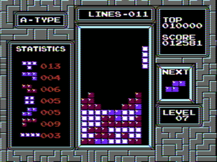
- Not overly concerned with the visual
- the visual play are is width: 10 times height: 20
- also a few hidden
- layout: 1440 x 1080
- 3 lanes
- 360 pixels on the left, A-Type header, Statistics
- 360 pixels on the right, Top Score, Current Score, Next Piece, Level
- 720 in the center, Lines counter, Main 10x20 Playfield
<pre style="background-color: #505050; color: #ffffff; padding:15px; margin:5px">
1. Canvas Scaler: Set your Canvas Scaler component to Scale With Screen Size and set the reference 
resolution to 1920 x 1080. Set the Screen Match Mode to Match Width or Height and push the slider 
completely to Height (1). 
This ensures your game doesn't clip off the top or bottom on wider screens.

2. UI Layout Panels: Create a central container GameObject centered on your canvas with a rigid size of 
1440 x 1080. 
Inside that container, use three separate UI panels aligned with Horizontal Anchors set to 25% (Left), 
50% (Center), and 25% (Right).

</pre>
- Change the Camera to make the math easier
- 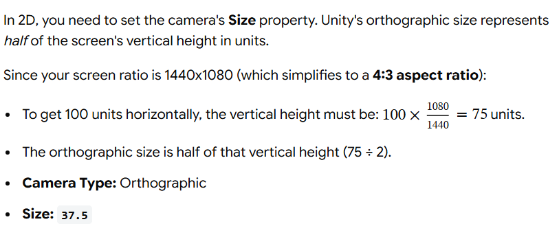
- H, Main Camera
    - Position: 0 0 -10
    - Rotation: 0 0 0
    - Scale: 1 1 1
    - Projection: Orthographic
    - Size: 37.5
### Build a Layout
- rclick H, add 2D Sprite, Square; rename "Left Border 1"
    - Position: -50 0 0
    - Rotation: 0 0 0
    - Scale: 0.1 75 1
- rclick H, add 2D Sprite, Square; rename "Right Border 2"
    - Position: 50 0 0
    - Rotation: 0 0 0
    - Scale: 0.1 75 1
- rclick H, add 2D Sprite, Square; rename "Top Border 1"
    - Position: 0 37.5 0
    - Rotation: 0 0 0
    - Scale: 100 0.1 1
- rclick H, add 2D Sprite, Square; rename "Bottom Border 1"
    - Position: 0 -37.5 0
    - Rotation: 0 0 0
    - Scale: 100 0.1 1
- rclick H, add 2D Sprite, Square; rename "Left Center Border 1"
    - Position: -50 0 0
    - Rotation: 0 0 0
    - Scale: 0.1 75 1
- rclick H, add 2D Sprite, Square; rename "Right Center Border 1"
    - Position: 50 0 0
    - Rotation: 0 0 0
    - Scale: 0.1 75 1
- layout
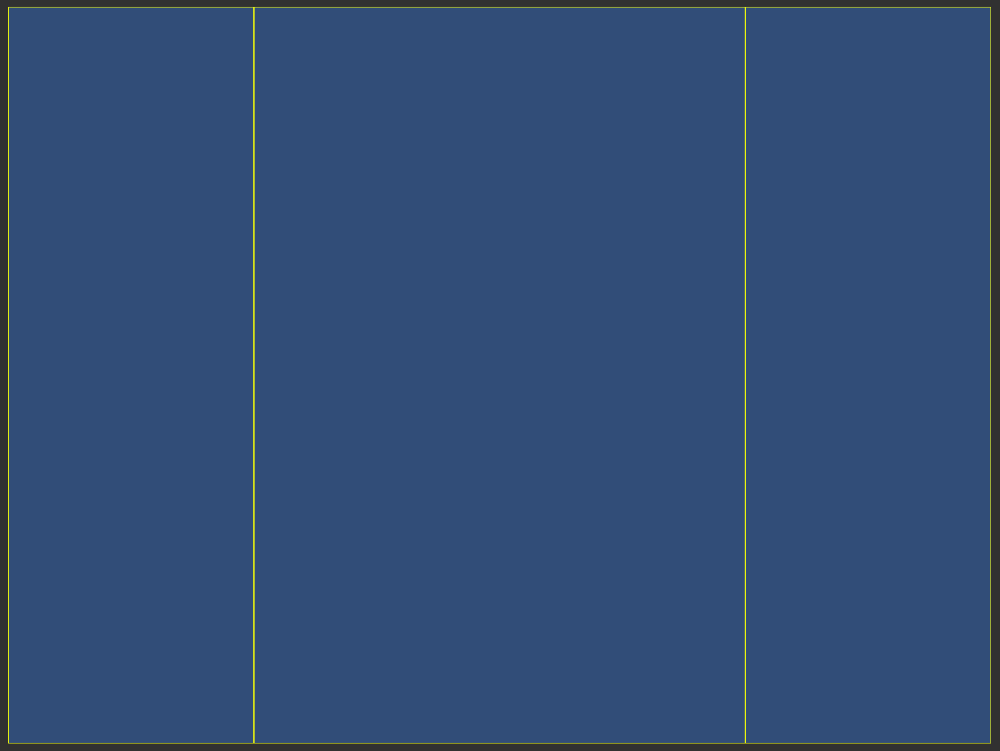
- and git 
<pre style="background-color: #505050; color: #ffffff; padding:15px; margin:5px">
PS C:\Users\steve\unity_projects\Unity_Tetris_NES> git add .
PS C:\Users\steve\unity_projects\Unity_Tetris_NES> git commit -m "Create a game layout"
[master 11d1040] Create a game layout
 2 files changed, 741 insertions(+), 46 deletions(-)
 create mode 100644 ProjectSettings/SceneTemplateSettings.json
</pre>
- set the Main Camera; Environment, Background to gray
- (probably should make a tetrissy like background for it later)

## Some UI Design/SetUp
- lets grab a font
- Press [Start 2P](https://fonts.google.com/specimen/Press+Start+2P) is recommended
- download the Zip, and extract
- gives you: PressStart2P-Regular.ttf
- rclick Assets; create Folder Fonts
- drag PressStart2P-Regular.ttf into A, Fonts
- need to fix this for unity use
- rclick A, PressStart2P-Regular; create TextMeshPro, Font Asset, SDF
    - trigger installation TMP Importer, Import TMP Essentials; Close
- Next lets add a Canvas
- rclick H; add (UI) Canvas, Canvas; rename Main Canvas
    - Scale with Screen Size
    - Reference Resolution: 1920 x 1080
- rclick H, Main Canvas; create Panel; name Left Panel
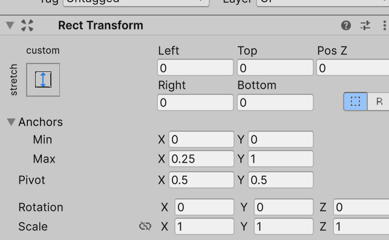
- rclick H, Main Canvas; create Panel; name Center Panel
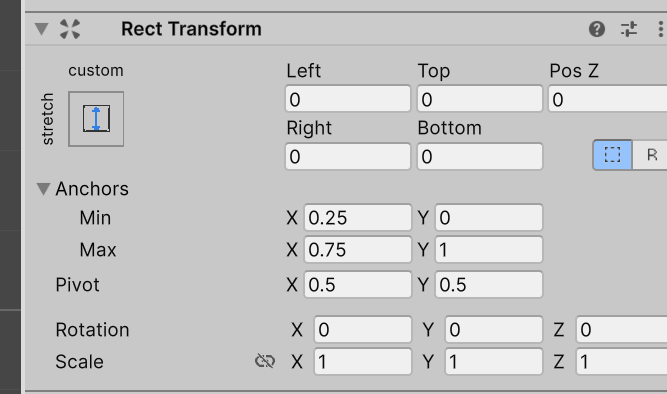
- rclick H, Main Canvas; create Panel; name Right Panel
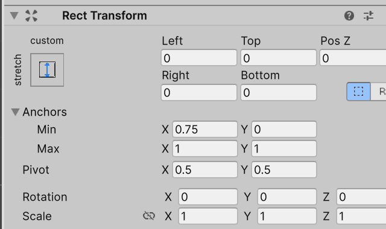
- for now, lets add some sample text
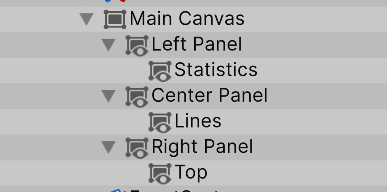
- will tune this later
- git break

## Building Blocks and Grid design 
- so what is the basic block? 
- Lets go with 3x3, I guess
- so make a square, with x = -18
- prefab it, name it cell, edit it, zero its position
- remove the original from H
- rclick H; create Empty, name Grid
- rclick H, Grid; create Empty, name Row
- drag A, Prefabs, Cube onto H, Grid, Row
- and dupe, add 3.1 to it, so X: -14.9
- and dupe that, add 3.1 to it, so X: -11.8
- and dupe that, add 3.1 to it, ...
- ...
- and dupe that, add 3.1 to it, so X: 9.9
- dupe H, Grid, Row
    - Position: 0 3.1 0
- make a total of 22 rows. NOTE: the last two will not be visible
- Row(21) and Row(20) is where we will place the "next" piece
- drag the Grid into Prefabs
- reposition Grid to 3.1 -3.1
- we will redo grid scale and position, maybe.
- set the alpha of the Cells in Row(20) and Row(21) to 0
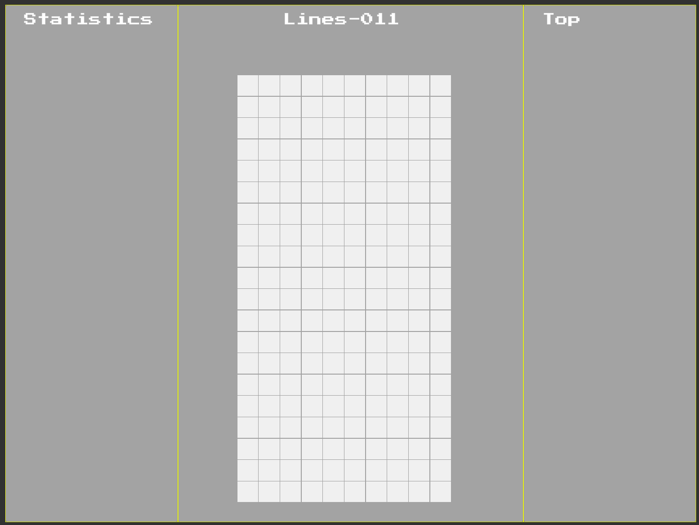
- set the alpha of the Cells in Row(20) and Row(21) to 255
- we will be setting all the boxes to alpha: 0 programmatically later
- git this

## Drawing a tetrimino (tetriminoes)
- there are a number of options, but we will use:
- 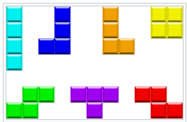
- they have names
- I, J, L, O, S, T, Z
- we will need to configure a scriptable object
- that object will store
    - four rotation positions
    - color code
- we will need a renderer 
    - take these scriptable object
    - take the orientation
    - take a grid location
    - paint (render) the shape correctly

#### Tetrimino Movements
- every possible rotation
- 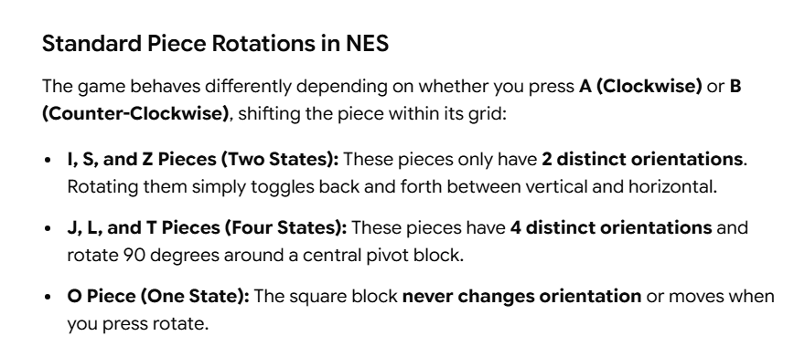
- I:
<pre style="background-color: #505050; color: #ffffff; padding:15px; margin:5px">
  Horizontal (Spawn)             Vertical
    [ ] [ ] [ ] [ ]          [ ] [ ] [X] [ ]
    [X] [X] [X] [X]    <=>   [ ] [ ] [X] [ ]
    [ ] [ ] [ ] [ ]          [ ] [ ] [X] [ ]
    [ ] [ ] [ ] [ ]          [ ] [ ] [X] [ ]

</pre>
- S:
<pre style="background-color: #505050; color: #ffffff; padding:15px; margin:5px">
  Horizontal (Spawn)             Vertical
    [ ] [ ] [ ]              [ ] [X] [ ]
    [ ] [X] [X]        <=>   [ ] [X] [X]
    [X] [X] [ ]              [ ] [ ] [X]
         ^                        ^ 
     Pivot Block              Pivot Block
</pre>
- Z:
<pre style="background-color: #505050; color: #ffffff; padding:15px; margin:5px">
  Horizontal (Spawn)             Vertical
    [X] [X] [ ]              [ ] [ ] [X]
    [ ] [X] [X]        <=>   [ ] [X] [X]
    [ ] [ ] [ ]              [ ] [X] [ ]
         ^                        ^ 
     Pivot Block              Pivot Block
</pre>
- T:
<pre style="background-color: #505050; color: #ffffff; padding:15px; margin:5px">
 State 0 (Spawn)        State 1 (Right)        State 2 (Upside)       State 3 (Left)
   [ ] [ ] [ ]            [ ] [X] [ ]            [ ] [ ] [ ]            [ ] [X] [ ]
   [X] [X] [X]     =>     [ ] [X] [X]     =>     [X] [X] [X]     =>     [X] [X] [ ]
   [ ] [X] [ ]            [ ] [X] [ ]            [ ] [X] [ ]            [ ] [X] [ ]
        ^                      ^                      ^                      ^
   Pivot Block            Pivot Block            Pivot Block            Pivot Block
</pre>

- L:
<pre style="background-color: #505050; color: #ffffff; padding:15px; margin:5px">
 State 0 (Spawn)        State 1 (Right)        State 2 (Upside)       State 3 (Left)
   [ ] [ ] [ ]            [ ] [X] [X]            [ ] [ ] [ ]            [ ] [X] [ ]
   [X] [X] [X]     =>     [ ] [X] [ ]     =>     [X] [X] [X]     =>     [ ] [X] [ ]
   [X] [ ] [ ]            [ ] [X] [ ]            [ ] [ ] [X]            [X] [X] [ ]
        ^                      ^                      ^                      ^
   Pivot Block            Pivot Block            Pivot Block            Pivot Block
</pre>

- J:
<pre style="background-color: #505050; color: #ffffff; padding:15px; margin:5px">
 State 0 (Spawn)        State 1 (Right)        State 2 (Upside)       State 3 (Left)
   [ ] [ ] [ ]            [ ] [X] [ ]            [ ] [ ] [ ]            [X] [X] [ ]
   [X] [X] [X]     =>     [ ] [X] [ ]     =>     [X] [X] [X]     =>     [ ] [X] [ ]
   [ ] [ ] [X]            [ ] [X] [X]            [X] [ ] [ ]            [ ] [X] [ ]
        ^                      ^                      ^                      ^
   Pivot Block            Pivot Block            Pivot Block            Pivot Block
</pre>

- O:

<pre style="background-color: #505050; color: #ffffff; padding:15px; margin:5px">
 State 0 (Spawn)
   [X] [X]
   [X] [X]
</pre>

### Representing a Tetrimino
- need a way to represent these shapes
- a bitmap is doable, but perhaps matrix is better?
- ok, lets just use a array of 16 Colors for now
- assume #FFFFFF (White) is empty
- then as an example
<pre style="background-color: #505050; color: #ffffff; padding:15px; margin:5px">
  Horizontal (Spawn) 
    [ ] [ ] [ ] [ ]  #ffffff, #ffffff, #ffffff, #ffffff,
    [X] [X] [X] [X]  #00f0f0, #00f0f0, #00f0f0, #00f0f0,
    [ ] [ ] [ ] [ ]  #ffffff, #ffffff, #ffffff, #ffffff,
    [ ] [ ] [ ] [ ]  #ffffff, #ffffff, #ffffff, #ffffff
</pre>
- 00f0f0h is 61,680 decimal (cyan blue)

### Model
- the play matrix is 22 (0-21)
- the display of this matrix is from the bottom up
- for now, ignore collision
- when I go to draw the shape, loop through the array
- if the color is not white, then paint the relative position that color
- what if it is out of bounds? that's fine if the color is white
- so lets move a O (the block) through the matrix
... need more discussion here ...

### Modeling the Grid
- rclick A; create folder Scripts
- setup a Namespace   (assuming you want one; I do.)
    - Edit-Project Settings, Editor, Root Namespace
    - Click on the Editor category on the left sidebar.
    - Scroll down to the C# Project Generation section.
    - Root namespace: Tetris
    - Close
- rclick A, Scripts; create Mono; name GridManager
- give the project a minute to compile that
- open GridManager script
- do the 7,17d thing (delete the start/update template stuff)
- save, unity
- and boom, unrelated errors... Unity tried to unalive itself.
- fix fix fix. google. fix fix. All fixed? Lets hope.
- git break.
- ok, drag A, Scripts, GridManager on H, Grid
- edit the script
<pre style="background-color: #505050; color: #ffffff; padding:15px; margin:5px">

        [SerializeField] private GameObject[] cells = new GameObject[220];

        void Start()
        {
            cells[216].GetComponent<SpriteRenderer>().color = new Color(0f, 240f / 255f, 240f / 255f);
            cells[219].GetComponent<SpriteRenderer>().color = new Color(0f, 240f / 255f, 240f / 255f);

        }
        private int GetArrayLocation(int x, int y) 
        {
            return x * 10 + y;
        }
        private int GetX(int index)
        {
            return index / 10;
        }
        private int GetY(int index)
        {
            return (index - (index / 10) * 10);
        }
    }
</pre>
- save, unity
- assign all the cells, in order
- RECALL the order is backwards
- so row 21, 6
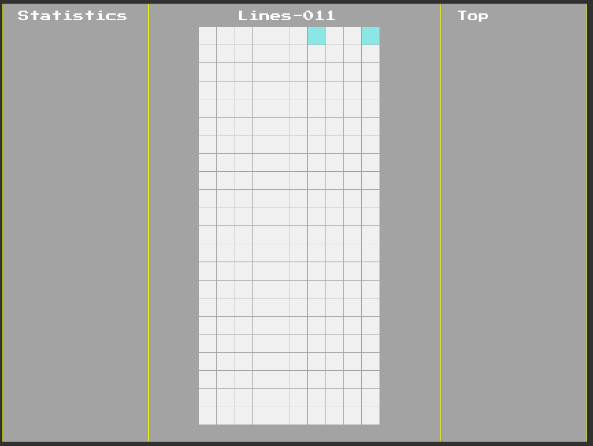

### Color break
- first, set alpha of panels to 0
- H, Main Canvas, Left Panel
    - Color: A: 0
- H, Main Canvas, Center Panel
    - Color: A: 0
- H, Main Canvas, Right Panel
    - Color: A: 0

- create Palette script, to simplify color management
<pre style="background-color: #505050; color: #ffffff; padding:15px; margin:5px">
using UnityEngine;

public class Palette
{
   public static Color Magenta = new Color(0f, 240f / 255f, 240f / 255f);
   public static Color Blue = new Color(0f, 0f, 240f / 255f);
   public static Color Orange = new Color(240f / 255f, 160f / 255f, 0f);
   public static Color Yellow = new Color(241f / 255f, 240f / 255f, 0f);
   public static Color Green = new Color(1f / 255f, 239f / 255f, 0f);
   public static Color Purple = new Color(157f / 255f, 1f / 255f, 235/255f);
   public static Color Red = new Color(241f / 255f, 0f , 0f);
}
</pre>
- do some testing ; open GridManager
<pre style="background-color: #505050; color: #ffffff; padding:15px; margin:5px">
        void Start()
        {
            AssignColor(21, 6, Palette.Magenta);
            AssignColor(21, 9, Palette.Blue);
            AssignColor(20, 6, Palette.Orange);
            AssignColor(20, 9, Palette.Yellow);
            AssignColor(19, 6, Palette.Green);
            AssignColor(19, 9, Palette.Purple);
            AssignColor(18, 6, Palette.Red);
        }

        private void AssignColor(int x, int y, Color c)
        {
            c.a = 1f; // set alpha
            int index = GetArrayLocation(x, y);
            cells[index].GetComponent<SpriteRenderer>().color = c;
        }
</pre>
- save, and run
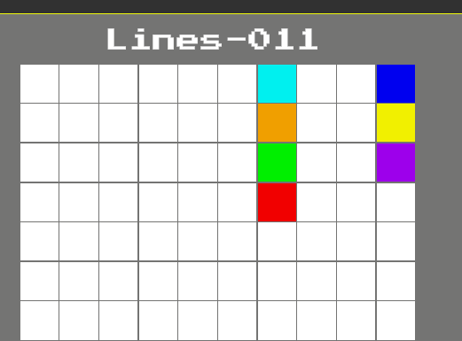

### Lets move a tetro through the matrix
- create GameManager Singleton
- rclick H; create empty; name GameManager
- drag the script on it
- open script, do the 7,17d thing
- oh dear, the namespace stuff is gone
- so project settings editor namespace stuff
- and try again
- 

...

- create a Scriptable Object called a Tetro
- contains a List of integers, offsets, from upper left corner
- and a color
- eg, a O shape:
<pre style="background-color: #505050; color: #ffffff; padding:15px; margin:5px">
0,-10,1, 9
Yellow
</pre>
- 
- First, lets modify Palette to be more useful for Unity
<pre style="background-color: #505050; color: #ffffff; padding:15px; margin:5px">
...
   public static Color White = new Color(1f, 1f , 1f);

   public static Color GetColor(PaletteColor colorEnum)
   {
       return colorEnum switch
       {
           PaletteColor.Magenta => Magenta,
           PaletteColor.Blue => Blue,
           PaletteColor.Orange => Orange,
           PaletteColor.Yellow => Yellow,
           PaletteColor.Green => Green,
           PaletteColor.Purple => Purple,
           PaletteColor.Red => Red,
           PaletteColor.White => White,
           _ => Color.white
       };
   }
}
public enum PaletteColor
{
    Magenta, Blue, Orange, Yellow, Green, Purple, Red, White
}
</pre>
- then, in GameManager (for the moment)
<pre style="background-color: #505050; color: #ffffff; padding:15px; margin:5px">
...
       [SerializeField] private GridManager gridManager;
       [SerializeField] private Tetro testTet;

       int position = 210;
       private float timeElapsed = 0f;
       private float totalTime = 5f;

       private void Start()
       {
           StartCoroutine(Test());
       }
       private IEnumerator Test()
       {
           float localWait = 0;
           while (position >0) //timeElapsed < totalTime)
           {
               if (localWait > 0.5f)
               {
                   EraseTet(testTet);
                   position = position - 10;
                   if (position < 0) position = 0;
                   DrawTet(testTet);
                   Physics2D.SyncTransforms();
                   localWait = 0;
               } else
               {
                   localWait += Time.deltaTime;
               }
               timeElapsed += Time.deltaTime;
               yield return null;
           }
       }

       private void EraseTet(Tetro t)
       {
           RenderTet(t.shape, Palette.White);
       }

       private void DrawTet(Tetro t)
       {
           RenderTet(t.shape, t.ActiveColor);
       }

       private void RenderTet(List<int> x, Color c)
       {
           foreach (int i in x)
           {
               gridManager.UpdatePosition(position + i, c); 
           }
       }
   }
</pre>
- note that this logic will be ported out
- but for now it lets me test each shape
- need a scriptable object
<pre style="background-color: #505050; color: #ffffff; padding:15px; margin:5px">
using UnityEngine;
using System.Collections.Generic;

namespace Tetris
{
    [CreateAssetMenu(fileName = "Tetro", menuName = "Tetro")]
    public class Tetro : ScriptableObject
    {
        [SerializeField] public List<int> shape = new List<int>();
        [SerializeField] public PaletteColor chosenColor = PaletteColor.Yellow;

        public Color ActiveColor => Palette.GetColor(chosenColor);

    }
}
</pre>
- save, unity
- rclick A; create folder Tets
- rclick Tets; create Tetro; name O
    - Element 0: 0
    - Element 1: -10    
    - Element 2: 1    
    - Element 3: -9    
    - Chosen Color: Yellow
- assign this tetro (O) to GameManager
- build the rest :-)
- end up with I, J, L, O, S, T, Z
- test each using GameManager
- git break

### Collision Logic
- simply check if the proposed position has an alpha greater than 0
- add to GridManager
<pre style="background-color: #505050; color: #ffffff; padding:15px; margin:5px">
        public bool HasCollision(int pos)
        {
            if (pos < 0 || pos > cells.Length) return true;

            if (cells[pos].GetComponent<SpriteRenderer>().color.a > 0)
            {
                return true;
            }
            return false;
        }
</pre>
- add to GameManager
<pre style="background-color: #505050; color: #ffffff; padding:15px; margin:5px">
        private bool TestRender(List<int> x)
        {
            bool flag = false;
            foreach (int i in x)
            {
                if (gridManager.HasCollision(position + i))
                {
                    flag = true;
                    break;
                }
            }
            return flag;
        }
</pre>
- note: need to move this at some point
- and tweak the Test code
<pre style="background-color: #505050; color: #ffffff; padding:15px; margin:5px">
        private IEnumerator Test()
        {
            float localWait = 0;
            while (position >0) //timeElapsed < totalTime)
            {
                if (localWait > 0.5f)
                {
                    EraseTet(testTet);
                    position = position - 10;
                    if (!TestRender(testTet.shape))
                    {
                        DrawTet(testTet);
                    }
                    else
                    {
                        position = position + 10;
                        DrawTet(testTet);
                        Debug.Log("Fini-via Collision");
                        yield break;
                    }
                    Physics2D.SyncTransforms();
                    Debug.Log("In Situ");
                    localWait = 0;
                } else
                {
                    localWait += Time.deltaTime;
                }
                timeElapsed += Time.deltaTime;
                yield return null;
            }
            Debug.Log("Fini");
        }
</pre>
- save, test, the piece should fall np
<pre style="background-color: #505050; color: #ffffff; padding:15px; margin:5px">
        private void Start()
        {
            StartCoroutine(Tests());
        }
        private IEnumerator Tests()
        { 
            yield return StartCoroutine(Test());
            position = 210;
            yield return StartCoroutine(Test());
            position = 210;
            yield return StartCoroutine(Test());
            position = 210;
        }
</pre>
- I tweaked the code a bit:
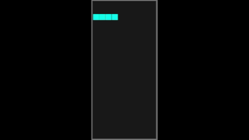
- bug: need to check for side collisions
- git break for now

## Rotations
- so, rotation via math, or rotation  via static?
- well, lets try static
- first lets modify the Tetro SO so it can handle a list of rotations
- we will need to redo the shapes
- first the new Tetro
<pre style="background-color: #505050; color: #ffffff; padding:15px; margin:5px">
using UnityEngine;
using System.Collections.Generic;

namespace Tetris
{
    [CreateAssetMenu(fileName = "Tetro", menuName = "Tetro")]
    public class Tetro : ScriptableObject
    {
        [SerializeField] public List<TetroShape> shapes = new List<TetroShape>();

    }
    [System.Serializable]
    public class TetroShape
    {
        [SerializeField] public List<int> shape = new List<int>();
        [SerializeField] public PaletteColor chosenColor = PaletteColor.Yellow;
        public Color ActiveColor => Palette.GetColor(chosenColor);

    }
}
</pre>
- and GameManager
<pre style="background-color: #505050; color: #ffffff; padding:15px; margin:5px">
        private IEnumerator Tests()
        {
            int offset = 0;
            foreach (Tetro t in tets)
            {
                TetroShape ts = t.shapes[0];
                yield return StartCoroutine(Test(ts, 210+offset));
                offset += 2;
            }
        }
</pre>
- and modify the signatures to take a TetroShape instead of Tetros
<pre style="background-color: #505050; color: #ffffff; padding:15px; margin:5px">
 00  01  02  03
-10  -9  -8  -7
-20 -19 -18 -17 
-30 -29 -28 -27
</pre>
- with that reference, and the earlier rotation notes
- rebuild with all shapes
- move the shape selection to the Test code
- add code to rotate
- bug: collision still not working
- we check for collision before the rotation, then rotate and then render
- ah i see
- so rotation is collide-able, and can fail
- probably due to the rotation
- lets add manual rotation for better testing

#### Add in some Controls
- movement will be:
<pre style="background-color: #505050; color: #ffffff; padding:15px; margin:5px">
• Rotate: Up Arrow
• Move Left/Right: Left / Right Arrows
• Soft Drop: Down Arrow
• Hard Drop: Spacebar
</pre>
- open GameManager
- add import/using
<pre style="background-color: #505050; color: #ffffff; padding:15px; margin:5px">
using UnityEngine.InputSystem;
</pre>
- scan each frame for input
- note: (yes, the OnMove approach is better, but requires much more code)
<pre style="background-color: #505050; color: #ffffff; padding:15px; margin:5px">
        void Update()
        {
            if (Keyboard.current.rightArrowKey.wasPressedThisFrame)
            {
                Debug.Log("Move Right");
            }
            if (Keyboard.current.leftArrowKey.wasPressedThisFrame)
            {
                Debug.Log("Move Left");
            }
            if (Keyboard.current.downArrowKey.wasPressedThisFrame)
            {
                Debug.Log("Soft Drop");
            }
            if (Keyboard.current.upArrowKey.wasPressedThisFrame)
            {
                Debug.Log("Rotate");
            }
            if (Keyboard.current.spaceKey.wasPressedThisFrame)
            {
                Debug.Log("Hard Drop");
            }
        }
</pre>
- save, unity, run
- pressing the left right up and down should trigger those messages
- test keys
<pre style="background-color: #505050; color: #ffffff; padding:15px; margin:5px">
...
[09:21:44] Hard Drop UnityEngine.Debug:Log (object)  
[09:21:46] Soft Drop UnityEngine.Debug:Log (object)  
[09:21:47] Rotate UnityEngine.Debug:Log (object)  
[09:21:48] Move Left UnityEngine.Debug:Log (object)  
[09:21:49] Move Right UnityEngine.Debug:Log (object)  
...
</pre>
- git break this

#### The Shapes are buggered
- ok, step back and rethink shapes
- recall that all shapes can be drawn via:
<pre style="background-color: #505050; color: #ffffff; padding:15px; margin:5px">
 00  01  02  03
-10  -9  -8  -7
-20 -19 -18 -17 
-30 -29 -28 -27
</pre>

- omg, the AI shapes earlier are wrong
- grab a reference (colors are wrong btw):
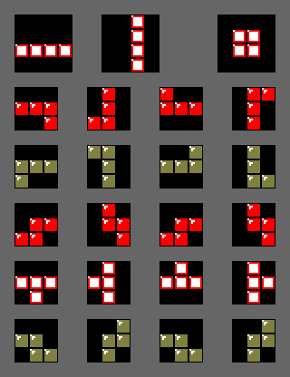
- and sigh, redo the shapes
- add an Editor widget
- A; create folder Editor
- A, Editor; create empty script
<pre style="background-color: #505050; color: #ffffff; padding:15px; margin:5px">
using UnityEditor;
using UnityEngine;

[CustomPropertyDrawer(typeof(Matrix4x4Data))]
public class Matrix4x4Drawer : PropertyDrawer
{
    public override void OnGUI(Rect position, SerializedProperty property, GUIContent label)
    {
        SerializedProperty rows = property.FindPropertyRelative("rows");

        // Ensure the array always has exactly 16 elements
        if (rows.arraySize != 16)
        {
            rows.arraySize = 16;
        }

        EditorGUI.BeginProperty(position, label, property);

        // Draw the main field prefix label (e.g., "My Grid")
        position = EditorGUI.PrefixLabel(position, GUIUtility.GetControlID(FocusType.Passive), label);

        // Calculate layout constraints
        float size = 18f; // Size of each checkbox
        float spacing = 4f; // Spacing between checkboxes

        // Loop through rows and columns to draw the 4x4 grid layout
        for (int r = 0; r < 4; r++)
        {
            for (int c = 0; c < 4; c++)
            {
                int index = r * 4 + c;
                SerializedProperty cell = rows.GetArrayElementAtIndex(index);

                // Compute exact position for this specific checkbox
                Rect boxRect = new Rect(
                    position.x + (c * (size + spacing)),
                    position.y + (r * (size + spacing)),
                    size,
                    size
                );

                // Draw the toggle checkbox
                cell.boolValue = EditorGUI.Toggle(boxRect, cell.boolValue);
            }
        }

        EditorGUI.EndProperty();
    }

    public override float GetPropertyHeight(SerializedProperty property, GUIContent label)
    {
        // Allocate vertical space for 4 rows of checkboxes plus spacing
        return (18f * 4) + (4f * 3);
    }
}

</pre>
- it needs a 4x4 matrix
- that can go in A, Scripts
- create empty script Matrix4x4Data
<pre style="background-color: #505050; color: #ffffff; padding:15px; margin:5px">
using System;

[Serializable]
public struct Matrix4x4Data
{
    // A 1D array of 16 elements represents our 4x4 grid
    public bool[] rows;

    // Helper method to access data like a 2D array in code
    public bool GetValue(int row, int col) => rows[row * 4 + col];
    public void SetValue(int row, int col, bool value) => rows[row * 4 + col] = value;
}
</pre>
- (yah, I stole that from the internet)
- next, modify the Tetro class
<pre style="background-color: #505050; color: #ffffff; padding:15px; margin:5px">
using UnityEngine;
using System.Collections.Generic;

namespace Tetris
{
    [CreateAssetMenu(fileName = "Tetro", menuName = "Tetro")]
    public class Tetro : ScriptableObject
    {
        [SerializeField] public List<TetroShape> shapes = new List<TetroShape>();
    }

    [System.Serializable]
    public class TetroShape
    {
        [SerializeField] public Matrix4x4Data xshape = new Matrix4x4Data(); 
        [HideInInspector] public List<int> shape = new List<int>();
        [SerializeField] public PaletteColor chosenColor = PaletteColor.Yellow;
        public Color ActiveColor => Palette.GetColor(chosenColor);

    }
}
</pre>
- it re-uses the previous logic, but will need to be configured
- in GameManager, add
<pre style="background-color: #505050; color: #ffffff; padding:15px; margin:5px">
...
        private void Start()
        {
            InitializeTetros(tets); // <--- HERE
            StartCoroutine(Tests());
        }
...
        private void InitializeTetros(List<Tetro> tets)
        {
            int i = 0;
            foreach(Tetro tet in tets)
            {
                
                foreach(TetroShape shape in tet.shapes)
                {
                    i = 0;
                    if (shape.xshape.GetValue(0,0)) shape.shape[i++] = 0;
                    if (shape.xshape.GetValue(0,1)) shape.shape[i++] = 1;
                    if (shape.xshape.GetValue(0,2)) shape.shape[i++] = 2;
                    if (shape.xshape.GetValue(0,3)) shape.shape[i++] = 3;

                    if (shape.xshape.GetValue(1,0)) shape.shape[i++] = -10;
                    if (shape.xshape.GetValue(1,1)) shape.shape[i++] = -9;
                    if (shape.xshape.GetValue(1,2)) shape.shape[i++] = -8;
                    if (shape.xshape.GetValue(1,3)) shape.shape[i++] = -7;

                    if (shape.xshape.GetValue(2,0)) shape.shape[i++] = -20;
                    if (shape.xshape.GetValue(2,1)) shape.shape[i++] = -19;
                    if (shape.xshape.GetValue(2,2)) shape.shape[i++] = -18;
                    if (shape.xshape.GetValue(2,3)) shape.shape[i++] = -17;

                    if (shape.xshape.GetValue(3,0)) shape.shape[i++] = -30;
                    if (shape.xshape.GetValue(3,1)) shape.shape[i++] = -29;
                    if (shape.xshape.GetValue(3,2)) shape.shape[i++] = -28;
                    if (shape.xshape.GetValue(3,3)) shape.shape[i++] = -27;
                }
            }
        }
</pre>
#### Rebuild the tets
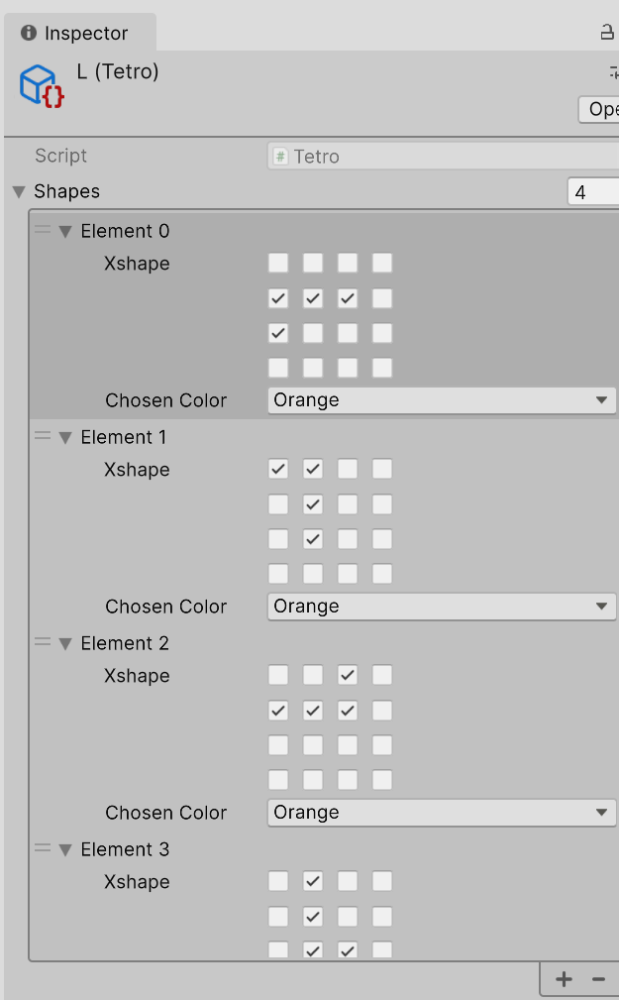
- much easier! Should have done this in the first place

#### Finally, back to Controls
- open GameManager, make mods
<pre style="background-color: #505050; color: #ffffff; padding:15px; margin:5px">
        private bool rotateAvailable = false;
        private int positionAvailable = 0;
...
        void Update()
        {
            if (Keyboard.current.rightArrowKey.wasPressedThisFrame)
            {
                positionAvailable = 1;
            }
            if (Keyboard.current.leftArrowKey.wasPressedThisFrame)
            {
                positionAvailable = -1;
            }
            if (Keyboard.current.downArrowKey.wasPressedThisFrame)
            {
                Debug.Log("Soft Drop");
            }
            if (Keyboard.current.upArrowKey.wasPressedThisFrame)
            {
                rotateAvailable = true;
            }
            if (Keyboard.current.spaceKey.wasPressedThisFrame)
            {
                Debug.Log("Hard Drop");
            }
        }

...
        private int UpdatePosition(int position)
        {
            position += positionAvailable;
            positionAvailable = 0;
            return position;
        }
        private int UpdateRotation(int currentRotation)
        {
            if (rotateAvailable)
            {
                rotateAvailable = false;
                currentRotation++;
            }
            return currentRotation;
        }
...
        private IEnumerator Test(Tetro tet, int position)
        {
            int currentRotation = 0;
            int pastRotation = 0;

            TetroShape t = tet.shapes[0];

            float localWait = 0;
            while (position >0) 
            {
                if (localWait > 0.5f)
                {
                    EraseTet(t, position);
                    currentRotation = UpdateRotation(currentRotation) % tet.shapes.Count;
                    position = UpdatePosition(position);
                    t = tet.shapes[currentRotation];
                    position = position - 10;
                    if (!TestRender(t.shape, position))
                    {
                        DrawTet(t, position);
                        pastRotation = currentRotation;
                    }
                    else
                    { 
                        // collision occurred
                        t = tet.shapes[pastRotation];
                        position += 10;
                        DrawTet(t, position); 
                        yield break;
                    }
                    Physics2D.SyncTransforms();
                    localWait = 0;
                } else
                {
                    localWait += Time.deltaTime;
                }
                yield return null;
            }
        }
</pre>

- yah that's a lot
- lets leave soft drop and hard drop (aka slam) for later
- ok, lets drop em all
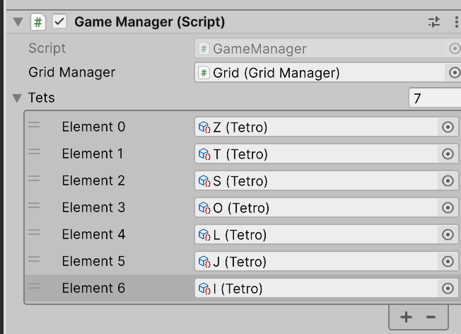
- need a movie
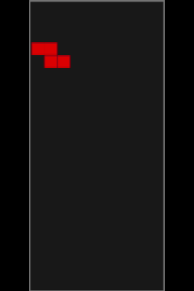
- and a git break; good work today

### Music break
- grab gregorquendel-tetris-theme-korobeiniki-arranged-for-piano-186249.mp3
- should donate, mention and say thank you in your code
- rclick A; create folder Sounds
- H, GameManager
    - add comp: Audio Source
    - Audio Generator: ... mp3
    - Volume: 0.5 (whatever you like)
    - Loop [x]
- I trimmed and edited the music a bit
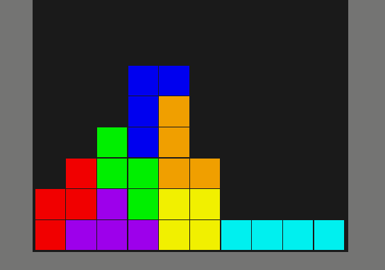

### Eliminate rows
- well, whenever the coroutine moving a tet down ends, check for lines
- oh, our grid layout:   (no complaining now!)
<pre style="background-color: #505050; color: #ffffff; padding:15px; margin:5px">
21 209 208 207 206 205 204 203 202 201 200
20 199 198 197 196 195 194 193 192 191 190
19 189 188 187 186 185 184 183 182 181 180
18 179 178 177 176 175 174 173 172 171 170
...
1   19  18  17  16  15  14  13  12  11  10
0    9   8   7   6   5   4   3   2   1   0
</pre>
- if row 1 is filled, then we want to copy
<pre style="background-color: #505050; color: #ffffff; padding:15px; margin:5px">
21 -> 20
20 -> 19
19 -> 18
...
 2 -> 1
</pre>
- start by making a method called : CopyRow(source, target)
- if 21 -> 20; then that is 
<pre style="background-color: #505050; color: #ffffff; padding:15px; margin:5px">
209 208 207 206 205 204 203 202 201 200
 |   |   |   |   |   |   |   |   |   |
 v   v   v   v   v   v   v   v   v   v
199 198 197 196 195 194 193 192 191 190
</pre>
- so in GridManager, add
<pre style="background-color: #505050; color: #ffffff; padding:15px; margin:5px">
        private void CopyRow(int source, int target)
        {
            int sourceStartPos = source * gridWidth - 1;
            int targetStartPos = target * gridWidth - 1;

            GameObject sourceObject;
            GameObject targetObject;
            SpriteRenderer sourceSR;
            SpriteRenderer targetSR;

            for (int i =0; i<gridWidth; i++)
            {
                sourceObject = cells[sourceStartPos+i];
                targetObject = cells[targetStartPos+i];

                sourceSR = sourceObject.GetComponent<SpriteRenderer>();
                targetSR = targetObject.GetComponent<SpriteRenderer>();

                if (sourceSR != null && targetSR != null)
                {
                    targetSR.color = sourceSR.color;
                }

            }

        }
</pre>
- that's rather verbose , and we can make it tighter later.
- next step, find lines
<pre style="background-color: #505050; color: #ffffff; padding:15px; margin:5px">
        public void ResolveLines()
        {
            bool flag = false;

            for (int i=21; i > 0; i--)
            {
                for (int j = 0; j < 10; j++)
                {
                    if (cells[i*10 -1 -j].GetComponent<SpriteRenderer>().color.a == 0)
                    {
                        flag = false;
                    } 
                }
                if (flag)
                {
                    RemoveLineAt(i - 1);
                }
                flag = true;
            }
        }
</pre>
- this calls RemoveLineAt
- NOTE: we can't copy down, we need to go in reverse
- otherwise we are just dropping an eraser
- no problem, just reverse the loop
<pre style="background-color: #505050; color: #ffffff; padding:15px; margin:5px">
        private void RemoveLineAt(int index)
        {
            for (int i = index+2; i< 21;  i++)
                CopyRow(i, i - 1);
        }
</pre>
- this works, at least for one line at a time
- git break

### Generate Fresh Bag of Tets
- open GameManager
- add
<pre style="background-color: #505050; color: #ffffff; padding:15px; margin:5px">
        private List<int> CreateDropOrder()
        {
            List<int> temp = new List<int>() { 0, 1, 2, 3, 4, 5, 6 };
            temp = temp.OrderBy(x => UnityEngine.Random.value).ToList();
            return temp;
        }
</pre>
- and modify
<pre style="background-color: #505050; color: #ffffff; padding:15px; margin:5px">
        private IEnumerator Tests()
        {
            int offset = 0;
            Tetro tet;
            List<int> dropOrder = new List<int>();

            while (true)
            {
                dropOrder = CreateDropOrder();
                foreach (int i in dropOrder)
                {
                    tet = tets[i];
                    yield return StartCoroutine(Test(tet, 210 + offset));
                }
            }
        }
</pre>

### Track Score
- basically count the number of lines
- open GameManager
- add 
<pre style="background-color: #505050; color: #ffffff; padding:15px; margin:5px">
        public int score = 0;
</pre>
- and
<pre style="background-color: #505050; color: #ffffff; padding:15px; margin:5px">
        public void UpdateScore()
        {
            score++;  // for now just increase score
        }
</pre>
- open GridManager and add simple call
<pre style="background-color: #505050; color: #ffffff; padding:15px; margin:5px">
        public void ResolveLines()
        {
            bool flag = false;

            Debug.Log("GridManager::ResolveLines called.");
            for (int i=gridHeight; i > 0; i--)
            {
...
                if (flag)
                {
                    RemoveLineAt(i - 1);
                    GameManager.Instance.UpdateScore(); // <--- HERE
                }
                flag = true;
            }
        }
</pre>

### Display Score
- Instead of tracking Top (as per original game) lets track Score
- H, Main Canvas, Right Panel, Top
    - rename to Score Label
    - Text Score:
- dupe H, Main Canvas, Right Panel, ScoreLabel; rename Score
    - Text 0000
    - Right Justify
- open GameManager script
- add SF
<pre style="background-color: #505050; color: #ffffff; padding:15px; margin:5px">
        [SerializeField] private TextMeshProUGUI ScoreText;
</pre>
-  
<pre style="background-color: #505050; color: #ffffff; padding:15px; margin:5px">
        void Update()
        {
            ScoreText.text = score.ToString("0000");
...
</pre>
- save, unity
- assign H, GameManager, Score Text: Score
- play for a bit, watch the score go up

### Increase Difficulty
- after each 10 lines, should increase speed a bit
- open GameManager
- create SF 
<pre style="background-color: #505050; color: #ffffff; padding:15px; margin:5px">
        [SerializeField] int rowToDifficuly = 10;
        [SerializeField] float diffIncrease = 0.05f;
...
        private int nextDifficultyRow =0;
</pre>
- initialize
<pre style="background-color: #505050; color: #ffffff; padding:15px; margin:5px">
        private void Start()
        {
            nextDifficultyRow = rowToDifficuly; // <-- HERE

            InitializeTetros(tets);
            StartCoroutine(Tests());
        }
</pre>
- modify Test  (note: we should start thinking about refactor soon)
<pre style="background-color: #505050; color: #ffffff; padding:15px; margin:5px">
        private IEnumerator Test(Tetro tet, int position)
        {
            int currentRotation = 0;
            int pastRotation = 0;

            TetroShape t = tet.shapes[0];// currentRotation%tet.shapes.Count];

            float localWait = 0;
            while (position >0) 
            {
                if (localWait > speed)
...
</pre>
- in update loop, check score
<pre style="background-color: #505050; color: #ffffff; padding:15px; margin:5px">
            if (score >= nextDifficultyRow)
            {
                speed = speed - diffIncrease;
                nextDifficultyRow = rowToDifficuly + nextDifficultyRow;
            }
</pre>
- note: this will, slowly increase the speed of the game
- in unity, you can tweak the values for testing
- for example, you can increase the score manually and see the values increase
- git break

### Display Next Tet
- need a 4x4 
- dupe MainGrid
    - 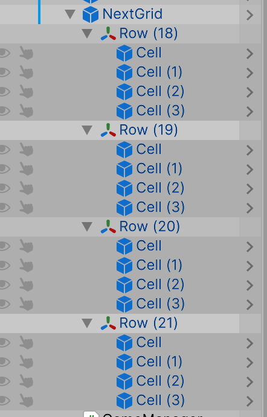
    - remove the MainGrid script
    - add a NextGrid script (will fill that in in a moment)
    - copy the Cells in (similar to before)
- open NextGrid
- setup similar to MainGrid (you can copy some code here)
- (and yah, we should probably optimize this)
<pre style="background-color: #505050; color: #ffffff; padding:15px; margin:5px">
namespace Tetris
{
    public class NextGrid : MonoBehaviour
    {
        [SerializeField] private GameObject[] cells = new GameObject[220];

        private void Start()
        {
            Color[] grid = new Color[220];
            UpdateGrid(grid);
        }
        public void UpdateGrid(Color[] newGrid)
        {
            if (newGrid == null) return;
            int length = Math.Min(cells.Length, newGrid.Length);
            for (int i = 0; i < length; i++)
            {
                cells[i].GetComponent<SpriteRenderer>().color = newGrid[i];
            }

        }
    }
}
</pre>
- we need to add a method to paint a Tet
- thinking
<pre style="background-color: #505050; color: #ffffff; padding:15px; margin:5px">
        public void RenderTet(Tetro tet)
        {
            for (int i = 0; i < 4; i++)
            {
                for (int j = 0; j < 4; j++)
                {
                    cells[i * 4 + j].GetComponent<SpriteRenderer>().color = Palette.Black;
                }
            }
            TetroShape tshape = tet.shapes[0];
            Debug.Log($"NextGrid::RenderTet ==> {tshape.shape[0]}, {tshape.shape[1]}, {tshape.shape[2]}, {tshape.shape[3]}");
            Matrix4x4Data m = tshape.xshape;
            Color t = Palette.Yellow;
            t.a = 1.0f;

            for (int i = 0; i < 4; i++) 
            {
                for (int j = 0; j < 4; j++)
                {
                    if (m.GetValue(i, j)) { 
                        cells[i * 4 + j].GetComponent<SpriteRenderer>().color = tshape.ActiveColor;
                    }
                }
            }
        }
</pre>
- pop back into GameManager
- add
<pre style="background-color: #505050; color: #ffffff; padding:15px; margin:5px">
        [SerializeField] private NextGrid nextGrid;
</pre>
- unity, assign Next Grd
- back to Game Manager
- currently, we are rebuilding the tet bag every 8 pieces
- however, we don't need to do that; we can make 9999 bags up front
- (its just a really big array)
- then we can (relatively) safely display the next one
- so Tests (really need to rename this now)
<pre style="background-color: #505050; color: #ffffff; padding:15px; margin:5px">
        private IEnumerator Tests()
        {
            int offset = 0;
            Tetro tet;
            Tetro nextTet;
            List<int> dropOrder = new List<int>();
            for (int i=0; i<10000; i++)
                dropOrder.AddRange( CreateDropOrder());

            while (true)
            {
                for (int i = 0; i < 10000; i++)
                {
                    tet = tets[dropOrder[i]];
                    nextTet = tets[dropOrder[i + 1]];

                    nextGrid.RenderTet(nextTet);
                    yield return StartCoroutine(Test(tet, 210 + offset));
                }
            }
        }
</pre>
- if anyone ever manages to get through 70000 tets... well that would be impressive.
- save, test
- Bug: it appears we are rendering a mirrored reflection in Next Grid
- no problem! in unity just change the order of the rows in your assignment
- to un mirror
- and run, and perfect :-) good for 70000 tets.
- git break

### End game
- game ends when you piece cannot drop initially
- so, if the position is 210 after we try moving
- then game over
- create a game over flag
- we will set that and use it to break out of loops
- open Game Manager
<pre style="background-color: #505050; color: #ffffff; padding:15px; margin:5px">
        private bool gameOver = false;
</pre>
- in test add logic
<pre style="background-color: #505050; color: #ffffff; padding:15px; margin:5px">
                    else
                    { 
                        // collision occurred
                        t = tet.shapes[pastRotation];
                        position += 10;
                        DrawTet(t, position); 
                        if (position  ==210) // <--- HERE
                        {
                            Debug.Log("---==== GAME OVER ====----");
                            gameOver = true;
			    GameOver();
                        }
                        Debug.Log("Fini-via Collision"); 
                        gridManager.ResolveLines();
                        yield break;
                    }
</pre>
- add the GameOver Code
<pre style="background-color: #505050; color: #ffffff; padding:15px; margin:5px">
        private void Start()
        {
            nextDifficultyRow = rowToDifficuly;
            InitializeTetros(tets);
            StartCoroutine(Tests());
        }

        private void GameOver()
        {
            Debug.Log("GameManager::GameOver called.");
            StopAllCoroutines();
            StartCoroutine(NewGame());
        }

        private IEnumerator NewGame()
        {
            yield return new WaitForSeconds(5f);
            SceneManager.LoadScene(SceneManager.GetActiveScene().buildIndex);
        }
</pre>
- this pauses for 5 seconds, and restarts the game
- probably should add more fanfare, but this works
- git break

### End Game Message
- rclick Main Canvas; add Panel; rename End Game Panel
    - Left: 0 Top: 0 Pos Z: 0
    - Right: 0  Bottom: 0
    - Min: 0.25 0.25
    - Max: 0.75 0.75
    - Pivot: 0.5 0.5
    - Rotation: 0 0 0
    - Scale: 1 1 1 
- rclick Main Canvas, End Game Panel; create Text, rename End Message
    - futz about with the Text
- H, End Game Panel
    - [ ] deactive
- open GameManager script
- add SF
<pre style="background-color: #505050; color: #ffffff; padding:15px; margin:5px">
        [SerializeField] private GameObject endPanel;
</pre>
- activate panel at NewGame
<pre style="background-color: #505050; color: #ffffff; padding:15px; margin:5px">
        private IEnumerator NewGame()
        {
            endPanel.SetActive(true);
            yield return new WaitForSeconds(5f);
            SceneManager.LoadScene(SceneManager.GetActiveScene().buildIndex);
        }
</pre>
- save, unity, assign the End Game Panel
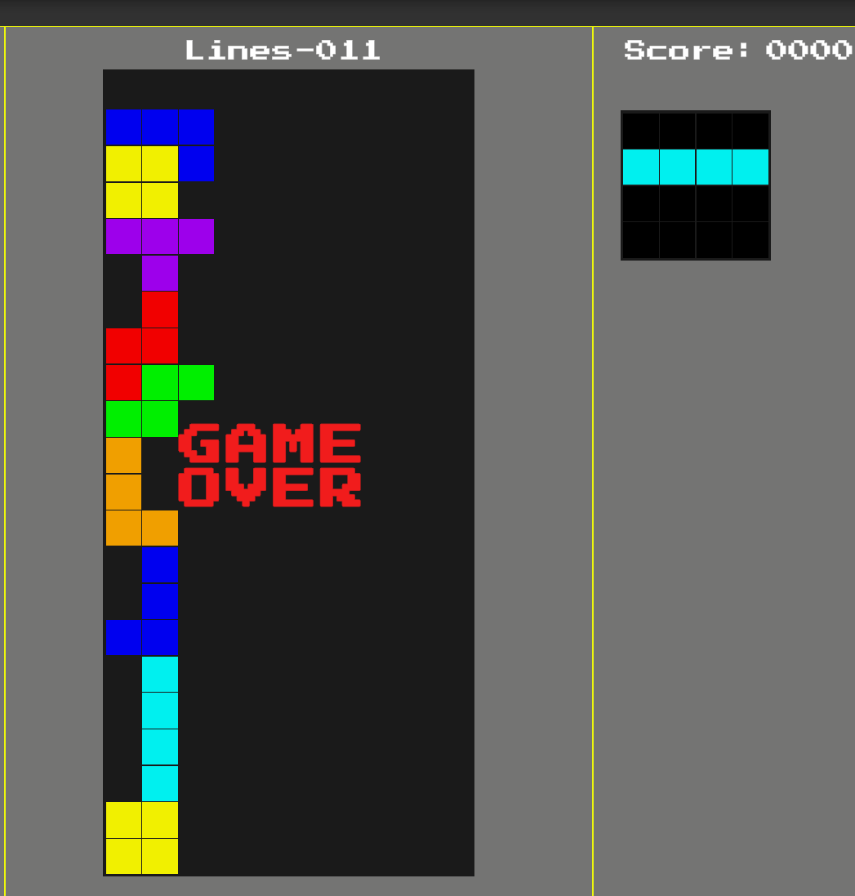
- git break

### Bugs
- collision issues - side movement into shapes
- collision issues - rotation
- able to move beyond sides 

### History
<pre style="background-color: #505050; color: #ffffff; padding:15px; margin:5px">
* 1c3b0a7 - add an end game message (Steve F, 4 minutes ago)
* c573055 - add end game logic, simple delay and restart for now (Steve F, 4 hours ago)
* 2f55269 - add black to palette, create Next Grid view (Steve F, 5 hours ago)
* f9712bf - minor bug, increase diff need to be linear (Steve F, 30 hours ago)
* 1837a9f - increase game difficulty (speed) after a certain number of rows (10) (Steve F, 30 hours ago)
* 2869f16 - add a Score to the UI, update in game update loop (Steve F, 30 hours ago)
* 404586e - add logic for tracking score (Steve F, 2 days ago)
* f990262 - some changes, including fonts?, that got missed (Steve F, 2 days ago)
* e8f14ed - added background music. added code to remove full line (Steve F, 3 days ago)
* 66e5b64 - config the tets (Steve F, 4 days ago)
* d66bcda - rebuild using new editing tool (Steve F, 4 days ago)
* 710495d - adding a custom tool for building tetros (Steve F, 5 days ago)
* 91e8ec5 - add setup for keyboard controls; left, right, rotate, soft down, hard down (Steve F, 5 days ago)
* 2ef8b7a - rotate the tetros. Had to rethink the Tetro class (Steve F, 6 days ago)
* 035b990 - drop some tetros (Steve F, 7 days ago)
* 30098b8 - mod Palette for unity, add test code to GameManager, add Tetros (base), and SO for Tets (base) (Steve F, 8 days ago)
* a602791 - unity went nuts and corrupted itself. So repairs. Sigh (Steve F, 12 days ago)
* 98a537e - add grid layout (Steve F, 13 days ago)
* 2eaee2c - Add UI (Steve F, 2 weeks ago)
* 11d1040 - Create a game layout (Steve F, 2 weeks ago)
* 54e8ec9 - Intial commit (Steve F, 2 weeks ago)
</pre>
